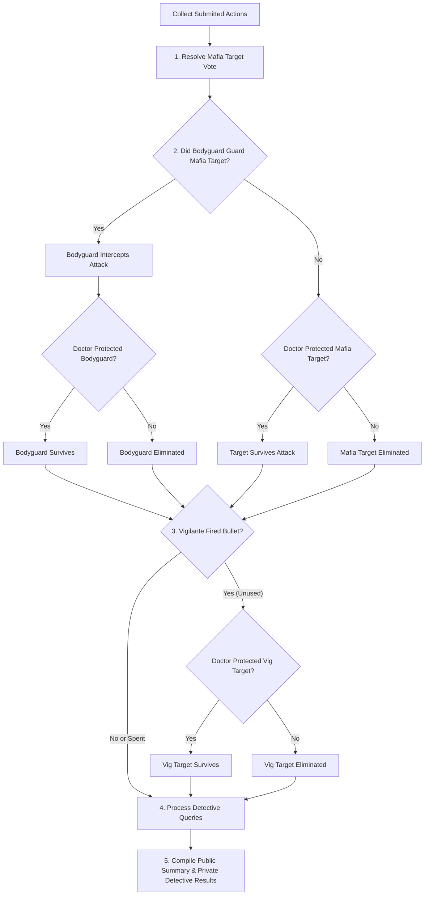
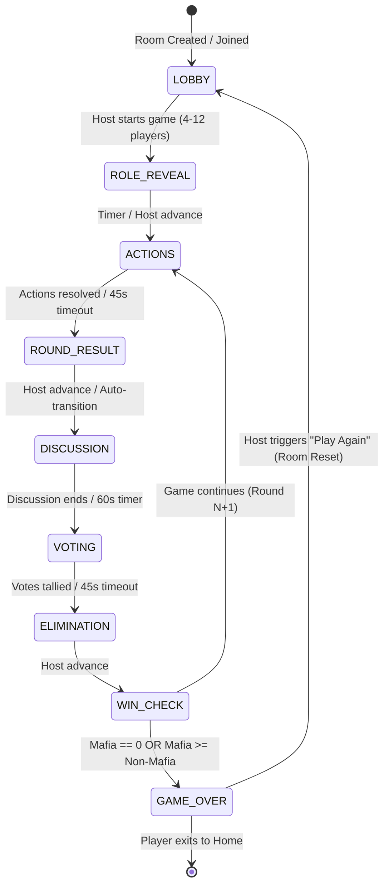
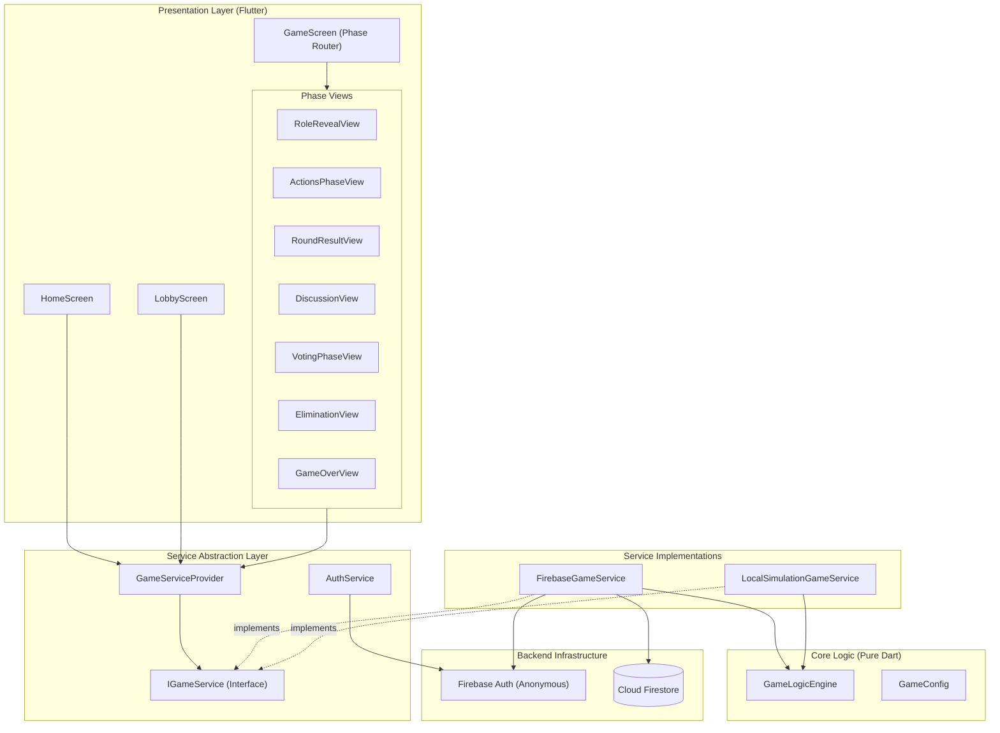

# Mafia — Real-Time Multiplayer Social-Deduction Engine

[](https://flutter.dev)
[](https://dart.dev)
[](https://firebase.google.com)
[]()
[]()

> A real-time mobile social-deduction game and distributed state machine built with **Flutter**, **Cloud Firestore**, and a deterministic **role resolution engine**. Players join private rooms via 6-character room codes, receive secret roles, and navigate timed rounds of private actions, town discussions, strategic voting, and eliminations.

---

## Overview

Mafia is not merely a party game UI—it is an end-to-end **real-time multiplayer system** engineered to orchestrate complex turn-based social-deduction matches on mobile devices. The architecture features:

* **Real-Time Distributed Room State:** Synchronized through Cloud Firestore document listeners and real-time streams across all participating clients.
* **Role-Based Game Engine:** Pure Dart logic engine (`GameLogicEngine`) handling role distribution, simultaneous action priority, bodyguard interceptions, doctor protections, vigilante one-shot mechanics, detective queries, and win condition evaluations.
* **Timed Round Progression:** Structured round-based flow with server-synchronized deadline timestamps (`actionsEndTimestamp`, `discussionEndTimestamp`, `votingEndTimestamp`).
* **Private State Isolation:** Architecture designed around separate public and private Firestore subcollections (`privatePlayerData`, `privateActions`, `privateVotes`, `privateResults`).
* **Live In-Match Discussion:** Real-time text messaging feed with rapid emoji reaction bars and automatic spectator mute for eliminated players.
* **Consensus-Driven Voting:** Secret candidate selection with live status indicators (`VOTED` vs `THINKING`), automated tallying, and deterministic tie-breaking.
* **Extensive Automated Verification:** A suite of 145 unit, logic, simulation, and widget tests—including Monte Carlo game balance simulations across 4–12 player distributions.

---

## Screenshots

*Screenshots coming soon.*

---

## Gameplay & Rules

### Core Objective

* **Civilian Team** (Civilian, Detective, Doctor, Bodyguard, Vigilante): Uncover, deduce, and vote out all Mafia members through discussion and coordinated abilities.
* **Mafia Team** (Mafia): Blend in with the town, eliminate civilian targets each round during the secret actions phase, and achieve numerical parity with living non-Mafia players.

### Win Conditions

* **Civilian Victory:** `livingMafia == 0` — All Mafia members are eliminated.
* **Mafia Victory:** `livingMafia >= livingNonMafia` — The Mafia equals or outnumbers living town members.

### Roles & Abilities

| Role | Team | Secret Action | Objective & In-Game Mechanics |
| :--- | :--- | :---: | :--- |
| **Mafia** 🔪 | Mafia | Yes | Secretly votes on an attack target each round. If multiple Mafia members submit conflicting targets, a majority vote determines the target (with alphabetical UID tie-breaking). |
| **Detective** 🕵️ | Civilian | Yes | Selects one living player per round to investigate. Receives a private result in their private results stream indicating whether the target is `isMafia: true/false`. |
| **Doctor** 🩺 | Civilian | Yes | Selects one player to shield each round. A protected player survives lethal Mafia attacks and Vigilante bullets during that round. |
| **Bodyguard** 🛡️ | Civilian | Yes | Guards another living player (cannot self-target). If the Mafia attacks the guarded player, the Bodyguard intercepts the strike: the guarded player survives, and the Bodyguard receives the lethal blow (unless also protected by the Doctor). |
| **Vigilante** 🎯 | Civilian | Yes | Town enforcer armed with **exactly one kill shot** per match. May choose to shoot or skip each round. Once the bullet is fired (`hasUsedAbility: true`), the ability is spent permanently. Target survives if shielded by the Doctor. |
| **Civilian** 👤 | Civilian | No | Possesses no nocturnal secret action. Relies on social deduction, behavioral analysis, chat debates, and daytime voting to eliminate suspects. |

### Deterministic Action Resolution Order

During the secret actions phase, actions resolve in a strictly defined priority order executed by `GameLogicEngine.resolveSecretActions`:



### Voting & Tie Resolution

* Every living player receives one secret vote.
* Players cannot vote for themselves.
* Votes are cast confidentially during the voting window.
* When the timer expires or all votes are submitted, votes are tallied.
* **Tie Rule:** If two or more players tie for the highest vote count, **no player is eliminated** ("NO CONSENSUS").
* Dead players are spectators: their voting controls are disabled, and they cannot influence the vote tally.

---

## Role Distribution Matrix

Role distribution is dynamically calculated via `GameLogicEngine.getRoleDistribution(playerCount)` to ensure balance across all supported room sizes:

### Production Player Counts (6–12 Players)

| Players | Mafia | Detective | Doctor | Bodyguard | Vigilante | Civilians | Town vs Mafia Ratio |
| :---: | :---: | :---: | :---: | :---: | :---: | :---: | :---: |
| **6** | 1 | 1 | 1 | 0 | 0 | 3 | 5 vs 1 |
| **7** | 2 | 1 | 1 | 0 | 0 | 3 | 5 vs 2 |
| **8** | 2 | 1 | 1 | 0 | 0 | 4 | 6 vs 2 |
| **9** | 2 | 1 | 1 | 1 | 0 | 4 | 7 vs 2 |
| **10** | 3 | 1 | 1 | 1 | 0 | 4 | 7 vs 3 |
| **11** | 3 | 1 | 1 | 1 | 1 | 4 | 8 vs 3 |
| **12** | 3 | 1 | 1 | 1 | 1 | 5 | 9 vs 3 |

### Testing & Small Group Mode (4–5 Players)

When running in testing mode (`GameConfig.testingMode = true`) or with automated mock bots:
* **4 Players:** 1 Mafia, 1 Detective, 1 Doctor, 1 Bodyguard
* **5 Players:** 1 Mafia, 1 Detective, 1 Doctor, 1 Bodyguard, 1 Vigilante

---

## Game State & Workflow

The application operates as a round-based state machine without traditional "day/night" terminology, progressing through distinct phases governed by `GamePhase`:



### Configured Phase Durations (`GameConfig`)

* **Secret Actions Phase:** 45 seconds (`defaultActionsDurationSeconds`)
* **Discussion Phase:** 60 seconds (`defaultDiscussionDurationSeconds`)
* **Voting Phase:** 45 seconds (`defaultVotingDurationSeconds`)
* **Chat Message Max Length:** 500 characters (`maxChatMessageLength`)
* **Room Capacity:** Minimum 4, Maximum 12 players (`minPlayers`, `maxPlayers`)

---

## Multiplayer & Room Architecture

### 1. Anonymous Authentication
* Users are signed in silently via Firebase Authentication (`AuthService.initializeAuth()`).
* Anonymous sessions persist UID across app restarts.
* If Firebase Auth is unreachable, a local fallback identifier (`local_XXXXXX`) is generated for offline/simulation modes.
* Player display names are validated (2–20 characters, trimmed, non-empty).

### 2. Room Lifecycle & Codes
* Rooms are identified by a human-friendly **6-character alphanumeric code** (e.g., `K7XM2P`) generated by `RoomCodeGenerator`.
* Excludes easily confused glyphs (`0`, `O`, `1`, `I`).
* Collision prevention performs up to 5 validation queries against active non-completed rooms.
* Late joining is prohibited once a match leaves `LOBBY` status.
* Maximum room capacity of 12 players is enforced on the join query.

### 3. Automatic Host Transfer & Host Claiming
* **Host Departure:** If the room host leaves while in the lobby or during gameplay, the player who joined earliest (`joinedAt` timestamp sort) automatically inherits the host role.
* **Host Failover:** If a host disconnects or stops advancing phases, any active living player can trigger `claimHost(roomId)` via a Firestore transaction to take over coordination.

### 4. Room Reset ("Play Again")
When a game concludes with `GAME_OVER`:
* The host can trigger `resetRoomForNewGame(roomId)`.
* Resets room status to `LOBBY`, round counter to `0`, and clears previous round winners, messages, and timestamps.
* Revives all players (`isAlive = true`, `role = unknown`) while keeping all connected players in the same lobby.
* Purges old round documents, private actions, votes, and chat feeds.

---

## Technical Architecture

The codebase follows a modular, reactive architecture with clear layer separation:



### Layer Breakdown

1. **Presentation Layer (`lib/screens/`, `lib/widgets/`):** Responsive Flutter widgets listening to Dart streams provided by the service interface. Phase views route dynamically through `GameScreen` based on `room.currentPhase`.
2. **Service Layer (`lib/services/`):**
   * `IGameService`: Abstract contract covering room creation, stream subscriptions, action submissions, phase advancements, timeouts, and resets.
   * `GameServiceProvider`: Singleton locator providing `FirebaseGameService` in production and enabling injection of test doubles.
   * `FirebaseGameService`: Production service communicating directly with Firestore collections and real-time snapshot streams.
   * `LocalSimulationGameService`: High-fidelity in-memory implementation supporting bot simulation, offline demos, and deterministic integration tests.
3. **Domain Engine (`lib/services/game_logic_engine.dart`):** Pure, testable static methods with zero external dependencies. Contains all game mathematics, resolution tables, tie-breakers, and win-condition algorithms.
4. **Data Models (`lib/models/`):** Immutable data transfer objects with explicit serialization/deserialization methods (`fromMap`, `toMap`, `copyWith`).

---

## Firebase & Firestore Data Architecture

All match data is organized under the top-level `rooms` collection in Cloud Firestore:

```
rooms/
  └── {roomId}/
        │
        │── (Document Fields: roomCode, hostId, status, currentRound,
        │    currentPhase, createdAt, maxPlayers, winner,
        │    eliminatedThisRound, votedOutThisRound, publicMessage,
        │    actionsEndTimestamp, discussionEndTimestamp, votingEndTimestamp)
        │
        ├── players/
        │     └── {uid}                (name, isAlive, isHost, isBot, joinedAt)
        │                              [Note: 'role' is omitted during PLAYING;
        │                               revealed here only after GAME_OVER]
        │
        ├── privatePlayerData/
        │     └── {uid}                (role, hasUsedAbility)
        │
        ├── messages/
        │     └── {messageId}          (senderId, senderName, message, timestamp)
        │
        ├── spectatorMessages/
        │     └── {messageId}          (senderId, senderName, message, timestamp, isSpectator)
        │
        └── rounds/
              └── {roundNumber}/
                    │
                    │── (Document Fields: roundNumber, actionsCount, votesCount,
                    │    actionsResolved, votesResolved, votedUids,
                    │    voteTally, eliminatedInActions, eliminatedInVote)
                    │
                    ├── privateActions/
                    │     └── {uid}           (targetId, role)
                    │
                    ├── privateVotes/
                    │     └── {uid}           (targetId)
                    │
                    └── privateResults/
                          └── {detectiveUid}  (targetId, isMafia, bodyguardIntercepted)
```

---

## Security Model: Intentional MVP Architecture

> [!NOTE]
> **Architectural Transparency:**
> To enable immediate deployment and evaluation on the **Firebase Spark (Free) plan** without requiring Blaze billing or external server hosting, this MVP employs a **client-coordinated execution model** rather than server-authoritative Cloud Functions.

### Current Implementation Characteristics

* **Authentication Required:** All read and write operations require valid Firebase Authentication (`request.auth != null`), as defined in [firestore.rules](file:///c:/Users/jinda/Downloads/Mafia-Game/firestore.rules).
* **Host as Game Coordinator:** The match host's client reads submitted actions and votes, invokes `GameLogicEngine`, and commits the resolved outcome back to Firestore.
* **Separation in Data Modeling:** Public and private state are physically separated into distinct subcollections (`privatePlayerData`, `privateActions`, `privateVotes`). While current development security rules permit authenticated room members to read/write under `/rooms/{roomId}`, the application layer strictly isolates streams so standard clients only listen to their respective data paths.
* **Why this is acceptable for MVP:** This design eliminates backend infrastructure costs, simplifies local testing, and allows instant testing with physical devices without deploying Node.js Cloud Functions.
* **V2 Hardening Path:** The Firestore data model was designed specifically so that a hardened backend (Cloud Functions, Dart Frog, or a Go/Node game server) can assume the role of the coordinator and enforce strict document-level rules without restructuring the Flutter client UI.

---

## Discussion & Voting System

### Real-Time Town Discussion
* **Living Discussion:** Living players communicate via a real-time message stream with a 500-character limit per message.
* **Quick Reactions:** Tap-to-send emoji bar (`🤔`, `👀`, `😂`, `❗`, `🫢`) for rapid feedback.
* **Spectator Mute:** Eliminated players have their chat input disabled and view a dedicated notice: *"Eliminated players cannot speak in town discussion."*
* **Spectator Channel:** Separate `spectatorMessages` stream available for eliminated players.

### Voting Mechanics
* **Candidate Roster:** All living players are presented in responsive candidate cards. Self-targeting is explicitly prevented.
* **Tally Transparency:** Aggregate vote counts (`votedCount / livingPlayersCount`) and individual progress badges (`✓ VOTED` vs `○ THINKING`) update live without exposing vote targets until resolution.
* **Countdown Enforcement:** `GameTimerWidget` tracks `votingEndTimestamp`. On expiry, the host client triggers `resolveVotesOnTimeout`, processing only submitted ballots and treating absent votes as abstentions.

---

## UI & Design System

The application features a modern, mobile-first **Cyber-Noir** aesthetic engineered in `AppTheme` and `AppColors`:

* **Color Palette:**
  * Background: Deep Void (`#080B12`)
  * Surface / Cards: Dark Obsidian (`#111722`) with elevated layers (`#171E2B`)
  * Primary Accent: Electric Violet (`#7C5CFF`)
  * Secondary Accent: Cyan / Sky Blue (`#38BDF8`)
  * Danger / Mafia: Crimson Red (`#EF4444`)
  * Doctor: Medical Green (`#22C55E`)
  * Bodyguard: Amber Shield (`#F59E0B`)
  * Vigilante: Purple Iris (`#A855F7`)
* **Mobile-First Ergonomics:** 56px minimum touch targets, distinct role identity badges, clear visual indicators for living vs eliminated players, and auto-scrolling chat feeds.
* **App Branding:** Official Mafia logo asset embedded at [assets/images/mafia_logo.png](file:///c:/Users/jinda/Downloads/Mafia-Game/assets/images/mafia_logo.png) and configured as the native Android/iOS launcher icon.

---

## Project Structure

```
Mafia-Game/
├── assets/
│   └── images/
│       └── mafia_logo.png               # Official Mafia vector/PNG asset
├── lib/
│   ├── main.dart                        # Entry point; initializes theme & splash
│   ├── firebase_options.dart            # Firebase platform configuration
│   ├── models/                          # Immutable domain models
│   │   ├── chat_message.dart            # Discussion and spectator chat model
│   │   ├── game_config.dart             # Tunable timing and capacity constants
│   │   ├── game_phase.dart              # Round-based game phase enum
│   │   ├── player.dart                  # Public player profile model
│   │   ├── player_role.dart             # Roles, descriptions, team mappings
│   │   ├── private_action.dart          # Secret action submission model
│   │   ├── private_player_data.dart     # Private role & ability state
│   │   ├── private_result.dart          # Detective investigation outcome
│   │   ├── private_vote.dart            # Secret ballot vote model
│   │   ├── room.dart                    # Room metadata, status & timer stamps
│   │   └── round_data.dart              # Round public state & vote tallies
│   ├── screens/                         # Top-level application screens
│   │   ├── splash_screen.dart           # App startup & auth initialization
│   │   ├── home_screen.dart             # Create room, display name, rules modal
│   │   ├── join_screen.dart             # 6-character room code entry screen
│   │   ├── lobby_screen.dart            # Pre-game lobby & player roster
│   │   └── game/                        # In-match phase views
│   │       ├── game_screen.dart         # Main router switching phase views
│   │       ├── role_reveal_view.dart    # Secret role presentation
│   │       ├── actions_phase_view.dart  # Secret action targeting controls
│   │       ├── round_result_view.dart   # Night resolution outcome
│   │       ├── discussion_view.dart     # Real-time discussion & chat
│   │       ├── voting_phase_view.dart   # Ballot casting & live progress
│   │       ├── elimination_view.dart    # Vote reveal & elimination screen
│   │       └── game_over_view.dart      # Final results, role reveal & reset
│   ├── services/                        # Service layer & game engine
│   │   ├── auth_service.dart            # Anonymous Firebase Auth manager
│   │   ├── game_logic_engine.dart       # Pure Dart role & action resolution engine
│   │   ├── game_service_interface.dart  # Abstract game service contract
│   │   ├── game_service_provider.dart   # Service locator with test injection
│   │   ├── firebase_game_service.dart   # Production Cloud Firestore service
│   │   └── local_simulation_game_service.dart # In-memory simulation service
│   ├── theme/
│   │   └── app_theme.dart               # Dark/Noir color tokens and ThemeData
│   ├── utils/                           # Helper utilities
│   │   ├── player_avatar.dart           # Role & player avatar generator
│   │   └── room_code_generator.dart     # 6-char alphanumeric room code engine
│   └── widgets/                         # Reusable UI component library
│       ├── chat_message_bubble.dart     # Styled message bubbles
│       ├── game_phase_indicator.dart    # Phase progress banner
│       ├── game_timer_widget.dart       # Animated circular countdown timer
│       ├── player_card.dart             # Player status card with action badges
│       ├── primary_button.dart          # Standard primary action button
│       └── room_code_display.dart       # Tap-to-copy room code badge
├── test/                                # Automated test suite (145 tests)
│   ├── balance_simulation_test.dart     # 700-game Monte Carlo balance test
│   ├── game_logic_test.dart             # 50 unit tests for GameLogicEngine
│   ├── phase3_features_test.dart        # 17 tests for expanded roles & chat
│   ├── real_players_production_smoke_test.dart # Production smoke tests
│   ├── room_multiplayer_test.dart       # Multi-client room lifecycle tests
│   ├── testing_mode_test.dart           # Mock bot and testing mode tests
│   ├── widget_test.dart                 # Widget tests & full game simulations
│   └── workflow_fixes_test.dart         # Edge cases & timeout recovery tests
├── firestore.rules                      # Firestore security rules
└── pubspec.yaml                         # Dependencies and asset declarations
```

---

## Local Development & Setup

### Prerequisites

* [Flutter SDK](https://flutter.dev/docs/get-started/install) (`>= 3.6.0 < 4.0.0`)
* [Dart SDK](https://dart.dev/get-dart) (`>= 3.10.8`)
* A configured [Firebase Project](https://console.firebase.google.com/) with **Authentication** (Anonymous enabled) and **Cloud Firestore** created.

### 1. Clone the Repository

```bash
git clone https://github.com/Pratham1708/my-blog.git
cd my-blog
```

### 2. Install Dependencies

```bash
flutter pub get
```

### 3. Configure Firebase

Because private Firebase credentials are not committed to public version control, configure your own Firebase project:

1. Install the FlutterFire CLI if you haven't already:
   ```bash
   dart pub global activate flutterfire_cli
   ```
2. Link your Firebase project:
   ```bash
   flutterfire configure
   ```
   This generates `lib/firebase_options.dart` for your specific project.
3. Deploy the included Firestore rules:
   ```bash
   firebase deploy --only firestore:rules
   ```

### 4. Run the Application

Launch on a connected mobile device, simulator, or desktop browser:

```bash
flutter run
```

---

## Testing & Quality Assurance

The repository includes a comprehensive automated test suite verifying game logic, concurrency edge cases, and multi-player phase flows.

```bash
# Run the pure logic engine unit tests (100% pass)
flutter test test/game_logic_test.dart

# Run the Phase 3 expanded roles & mechanics test suite (100% pass)
flutter test test/phase3_features_test.dart

# Run the 700-game balance simulation test
flutter test test/balance_simulation_test.dart

# Run static analysis
flutter analyze
```

### Test Suite Summary

* **`game_logic_test.dart` (50 tests):** Verifies role distribution sizing, Mafia alphabetical tie-breaking, doctor save outcomes, detective accuracy, voting ties, and win condition boundaries.
* **`phase3_features_test.dart` (17 tests):** Tests Bodyguard interception, Doctor saves on Bodyguards, Vigilante one-shot bullet consumption, and chat permissions.
* **`balance_simulation_test.dart`:** Simulates 100 full matches for each player count from 6 to 12 (700 total games), recording win percentages, average rounds, doctor saves, and bodyguard interceptions.

---

## Known Boundaries & Limitations

As an intentional MVP, the current codebase operates within the following parameters:

1. **Client-Coordinated Resolution:** The room host's device runs `GameLogicEngine` during phase transitions. Malicious clients with modified code could technically falsify reports if acting as room host.
2. **Permissive Rules for Authenticated Users:** Firestore rules require authentication but do not currently restrict document writes to specific roles, keeping the app functional on the Firebase Spark free plan.
3. **Subcollection Cleanup:** Because the Firestore client SDK cannot execute recursive collection deletes, abandoned room documents are removed on best-effort basis; orphaned private documents remain inaccessible under standard room queries.
4. **Internet Connectivity:** Requires an active internet connection to stream Firestore snapshot updates; offline gameplay is supported only via automated test runners and local simulation mode.
5. **No Built-in Voice Streaming:** Communications are currently text- and emoji-based. Voice communication is deferred to external channels (e.g., Discord) or future roadmap phases.

---

## Roadmap

### Completed (Current Implementation)
- [x] Real-time room creation and joining via 6-character room codes.
- [x] Anonymous Firebase Authentication session handling.
- [x] Pure deterministic `GameLogicEngine` with comprehensive test coverage.
- [x] 6 distinct character roles (Mafia, Detective, Doctor, Bodyguard, Vigilante, Civilian).
- [x] Dynamic role distribution tables for 4–12 player configurations.
- [x] Real-time discussion room with emoji reaction bar and spectator mute.
- [x] Confidential voting mechanism with live progress indicators and tie-handling.
- [x] Automatic host transfer on host departure and transactional host claiming.
- [x] "Play Again" room reset preserving lobby membership.
- [x] Native Android and iOS app launcher icons generated from official artwork.

### Planned (Future Versions)
- [ ] **Server-Authoritative Game Resolution:** Migrate game logic execution to Firebase Cloud Functions (Blaze) or a dedicated Dart/Go backend service.
- [ ] **Cryptographic Host Verification & Strict Firestore Rules:** Lock write access to validated server tokens.
- [ ] **In-App Proximity / Spatial Voice Chat:** Integrated audio channels with mute-on-death enforcement.
- [ ] **Public Matchmaking:** Global queue for finding games outside private room codes.
- [ ] **Persistent Player Accounts & Stats:** Elo rating, games played, win rate tracking, and player profiles.
- [ ] **Push Notifications:** Alerts when turns begin or a lobby reaches full capacity.

---

## Contributing

Contributions, issues, and feature proposals are welcome!

1. Fork the repository.
2. Create a feature branch (`git checkout -b feature/amazing-feature`).
3. Commit your changes (`git commit -m 'Add amazing feature'`).
4. Ensure tests and static analysis pass:
   ```bash
   flutter analyze
   flutter test test/game_logic_test.dart test/phase3_features_test.dart
   ```
5. Push to the branch (`git push origin feature/amazing-feature`).
6. Open a Pull Request.

---

## License

License: Not yet specified.
